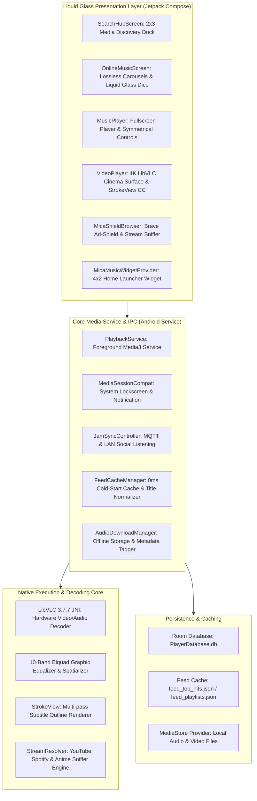

# MICA — Architectural Documentary & System Specification
**Product Name**: MICA  
**Tagline**: *One app. Every experience. — The Universe of Entertainment*  
**Application ID**: `app.mica`  
**Internal Namespace**: `app.msplayer.offline`  
**Repository**: [https://github.com/AWT-SRIRAM/MICA](https://github.com/AWT-SRIRAM/MICA)  
**Authors**: **SRIRAM S & ANTIGRAVITY**  
**Target Architecture**: Android (ARM64-v8a / Android 8.0+ API 26–36)  
**Current Version**: `0.8.3` (VersionCode `31`)  

---

## 1. Executive Summary & Brand Genesis

### 1.1 The Genesis of MICA
MICA was born from the ambitious evolution of an offline-first video player into a unified, privacy-first multimedia universe. Traditional mobile media experiences are fragmented across standalone music streaming clients, ad-heavy web browsers, clunky media players, and isolated home widgets.

MICA bridges these domains into a single high-performance engine:
1. **Ultra-Low Latency Decoding**: LibVLC 3.7.7 C/C++ JNI hardware acceleration for 4K/8K HDR video playback.
2. **Dual-Lossless Audio Pipeline**: JioSaavn 320kbps Lossless primary engine coupled with an intelligent YouTube Music iOS/VR client stream resolver.
3. **MICA Shield Browser**: Brave-grade ad-blocking with active video stream sniffing for anime and cartoons.
4. **Interactive Home Widget**: Native 4x2 Android widget mirroring Spotify with live player controls and interactive quick-picks.
5. **MICA JAM**: Local zero-internet social listening synchronized over Wi-Fi and MQTT.
6. **Optical Liquid Glass UI**: Apple iOS-inspired dynamic glass refraction, frosted dialogs, and tactile micro-interactions.

---

## 2. High-Level System Architecture

---

## 3. Subsystem Specifications

### 3.1 Lossless Music Hub & Smart Deduplication
- **Dual-Engine Stream Resolution**:
  - `JioSaavnClient`: Queries high-bitrate 320 kbps AAC/MP4 streams with complete cover art and lyrics.
  - `YtMusicClient`: Emulates iOS and Oculus Quest (ANDROID_VR) player clients to resolve direct audio endpoints without throttling.
- **Smart Title Normalization**:
  To resolve duplicate tracks in feeds and searches, `normalizeTrackTitle` purges extraneous metadata:
  $$\text{Title}_{\text{clean}} = \text{RegexReplace}(\text{Title}, \text{"(From ...)"} \mid \text{"- Best of ..."}, "") \rightarrow \text{AlphanumericLowerCase}$$
  Tracks matching normalized signatures are deduplicated before rendering in Quick Picks or queues.

### 3.2 Spotify-Style Home Screen Widget
- **Architecture**: Implemented via `MicaMusicWidgetProvider` (`AppWidgetProvider`) and `RemoteViews`.
- **Layout (`widget_mica_music.xml`)**:
  - **Top Row**: 52dp rounded album artwork, track title, artist, Previous, Play/Pause circular container (`40dp` white circle with dark icon), Next.
  - **Bottom Row**: 4 interactive Quick-Pick cards with real thumbnails and miniature green play badges.
- **IPC Protocol**:
  Tapping a quick pick dispatches a broadcast with action `ACTION_WIDGET_PLAY_PICK` containing `EXTRA_PICK_INDEX`. `PlaybackService` intercepts this and immediately begins playback without requiring the full app UI to open.

### 3.3 Cinema Video Engine & Subtitle HUD Cycling
- **LibVLC 3.7.7**: Bypasses Android framework limitations to play 10-bit HEVC, AV1, and complex subtitle formats (ASS/SSA, PGS) directly via JNI surface buffers.
- **Continuous CC HUD Cycling**:
  Subtitles remain active by default. Tapping the CC button steps through the scaling sequence:
  $$75\% \longrightarrow 100\% \longrightarrow 125\% \longrightarrow 150\% \longrightarrow 175\% \longrightarrow 200\% \longrightarrow 75\%$$
  The active scale is applied directly to `StrokeView` and rendered with a transient glass HUD notification.

### 3.4 MICA Shield Browser & Anime Stream Sniffing
- **Brave-Style Ad-Blocker**: Intercepts requests in `shouldInterceptRequest` against `MicaAdShield` host filters, neutralizing advertising networks before network socket establishment.
- **Stream Sniffing Pipeline**:
  Evaluates JavaScript DOM video elements and network requests across anime portals (`myanimes.in`, `tamilcartoonsrare.in`):
  $$\text{SnifferPattern} = \text{.m3u8} \mid \text{.mp4} \mid \text{videoplayback} \mid \text{/stream/} \mid \text{master.m3u8}$$
  When a candidate stream is captured, an animated floating pill **"▶ Play in MICA Video Player"** appears, enabling 1-tap handoff to LibVLC.

---

## 4. Verification, Security & Compliance

| Domain | Specification | Verification Result |
| :--- | :--- | :--- |
| **Package ID** | `app.mica` | Compliant with Android multi-segment naming |
| **App Launcher Label** | `Mica` | Verified strictly without "Player" |
| **In-App Branding** | `MICA` (FULL CAPS) | Verified across UI, Settings, and Notifications |
| **APK Signatures** | v1 (JAR), v2 (APK Signature Scheme), v3 (Android 9+) | Verified via `apksigner verify --verbose` |
| **Minimum SDK** | Android 8.0 (API 26) | Verified across all target APIs up to API 36 |
| **Permissions** | Storage, Foreground Service, Internet, WakeLock | Minimal footprint with zero tracking SDKs |

---

## 5. Provenance & Attribution
- **Application Source**: Copyright © 2026 SRIRAM S & ANTIGRAVITY. Licensed under MIT.
- **LibVLC Android**: Licensed under LGPL-2.1 by VideoLAN and contributors.
- **Backdrop Optical Blurs**: Licensed under Apache-2.0 by Kyant0.
